# 📈 Performance de Ações na B3 · 2021–2023

**Data App de Business Intelligence financeiro** · Projeto Final do Módulo 2 · Visualização de Dados e BI (SENAI/SC · LAB365)
**Linha 2: Performance de Mercado de Ações & Séries Temporais (B3)**

[](https://andre-performance-b3.streamlit.app/)
[](https://trello.com/b/95esWOEL/projetofinalt2)


| 🔗 Link | Endereço |
|---|---|
| **Aplicação em produção** | https://andre-performance-b3.streamlit.app/ |
| **Quadro Kanban (Trello)** | https://trello.com/b/95esWOEL/projetofinalt2 |
| **Vídeo de apresentação** | _link será adicionado após a publicação do vídeo_ |

---

## Sumário

1. [Título e Resumo Executivo](#1-título-e-resumo-executivo)
2. [Contexto de Negócio e Pergunta Orientadora](#2-contexto-de-negócio-e-pergunta-orientadora)
3. [Fonte de Dados e Licença](#3-fonte-de-dados-e-licença)
4. [Pipeline de Engenharia de Dados](#4-pipeline-de-engenharia-de-dados)
5. [Dicionário de Dados](#5-dicionário-de-dados)
6. [Tecnologias e Bibliotecas](#6-tecnologias-e-bibliotecas)
7. [Principais Resultados e Evidências Numéricas](#7-principais-resultados-e-evidências-numéricas)
8. [Discussão e Limitações da Análise](#8-discussão-e-limitações-da-análise)
9. [Aplicação Profissional e Decisões de Negócio](#9-aplicação-profissional-e-decisões-de-negócio)
10. [Demonstração do Data App](#10-demonstração-do-data-app-streamlit)
11. [Como Executar Localmente](#11-como-executar-localmente)
12. [Estrutura de Pastas](#12-estrutura-de-pastas)
13. [Gestão Ágil e Links do Projeto](#13-gestão-ágil-e-links-do-projeto)
14. [Autoria e Créditos](#14-autoria-e-créditos)

---

## 1. Título e Resumo Executivo

**Performance de Ações na B3 (2021–2023)** é um Data App que compara a rentabilidade, o risco e a tendência de **12 ações de 4 setores** negociadas na B3, tendo o **Ibovespa como referência**, ao longo de **745 pregões** (04/01/2021 a 28/12/2023).

O projeto cobre o ciclo completo de BI:

- **coleta** de cotações públicas;
- **pipeline reproduzível em Python**, com 21 verificações de qualidade e correção de um evento societário que a fonte não ajustou;
- **modelo dimensional no PostgreSQL** (Supabase);
- **aplicação interativa em Streamlit**, publicada na nuvem, com conexão resiliente, cache, filtros cruzados, 4 KPIs e 6 abas analíticas.

**Em uma frase:** no período, uma carteira com valor igual nas 12 ações teria rendido **+60,6%**, contra **+13,2%** do Ibovespa. Mas o desempenho foi muito desigual: **7 de 12** ações superaram o índice, de **+228,7%** (PETR4) a **−6,9%** (BBDC4).

---

## 2. Contexto de Negócio e Pergunta Orientadora

Entre 2021 e 2023, o mercado brasileiro passou por choques relevantes: a recuperação pós-pandemia, o ciclo de alta da Selic, a volatilidade das commodities e um ano eleitoral. Para um **investidor ou gestor de carteira**, olhar apenas o preço das ações não basta: é preciso comparar ativos de preços diferentes numa mesma base, medir **quanto risco** foi assumido para cada ponto de retorno e entender **quão fundas** foram as quedas no caminho.

**Pergunta orientadora:**
> *Quais ações da carteira entregaram o melhor retorno para o risco assumido entre 2021 e 2023, e o que o comportamento dos preços revela sobre a resiliência de cada setor?*

**Perguntas de negócio oficiais (edital, Linha 2), respondidas uma por aba do app:**

| # | Pergunta | Aba do app |
|---|---|---|
| P1 | Qual seria a rentabilidade comparativa normalizada (Base 100) de 2021 a 2023? | 📈 Base 100 |
| P2 | Quais ativos tiveram a melhor relação risco × retorno (Sharpe empírico)? | ⚖️ Risco × Retorno |
| P3 | Como se comportam estatisticamente os retornos diários (dispersão, assimetria e caudas)? | 📊 Distribuição |
| P4 | Qual foi o drawdown máximo de cada papel e qual se mostrou mais resiliente? | 📉 Drawdown |
| P5 | Como os preços se comportaram frente às médias móveis SMA 21 e SMA 50? | 〰️ Médias Móveis |

---

## 3. Fonte de Dados e Licença

| Item | Descrição |
|---|---|
| **Origem** | Cotações diárias da **B3** obtidas no **Yahoo Finance**, via biblioteca `yfinance` (sufixo `.SA`) |
| **Período** | 01/01/2021 a 31/12/2023 (período obrigatório do edital), ou seja, 745 pregões, de 04/01/2021 a 28/12/2023 |
| **Universo** | 12 ações sugeridas no edital + Ibovespa (`^BVSP`) como benchmark |
| **Variáveis** | Data, Abertura, Máxima, Mínima, Fechamento, Fechamento Ajustado (*Adj Close*) e Volume |
| **Método de extração** | Script `src/extract.py`: um download por ativo, com pausa entre chamadas e novas tentativas (respeito aos limites de requisição) |
| **Volume da base** | 9.685 registros (13 ativos × 745 pregões) |

**Agrupamento setorial (4 macrossetores):**

| Setor | Ativos |
|---|---|
| Indústria & Materiais | WEGE3 (WEG), EMBR3 (Embraer), VALE3 (Vale), GGBR4 (Gerdau), KLBN11 (Klabin) |
| Energia | PETR4 (Petrobras), PRIO3 (PRIO), EGIE3 (Engie Brasil) |
| Financeiro | ITUB4 (Itaú Unibanco), BBDC4 (Bradesco) |
| Consumo | ABEV3 (Ambev), RENT3 (Localiza) |

**Licença e uso dos dados:** as cotações são dados públicos de mercado, usados aqui **exclusivamente para fins educacionais**, de acordo com os termos de uso do Yahoo Finance. A biblioteca `yfinance` é um projeto de código aberto (licença Apache 2.0), não oficial e não afiliado ao Yahoo. **O projeto não utiliza dados pessoais, dados bancários de pessoas físicas nem informação privilegiada** (item 4.2 do edital).

---

## 4. Pipeline de Engenharia de Dados

```
 Yahoo Finance ──► extract.py ──► eventos.py ──► transform.py ──► metrics.py ──► load.py ──► Supabase (PostgreSQL)
                    (bruto)        (cisão)         (limpeza)       (indicadores)   (estrela)          │
                       │                                │               │                             ▼
                  data/raw/                       data/processed/  data/processed/          app.py (Streamlit)
                                                                   (contingência) ──────────────────►┘
```

| Etapa | Script | O que faz |
|---|---|---|
| **1. Extração** | `src/extract.py` | Baixa os 13 ativos com `auto_adjust=False` (mantém o *Adj Close*) e `multi_level_index=False` (colunas simples). Na rede corporativa, usa os certificados do Windows **sem desligar a verificação HTTPS** |
| **2. Eventos societários** | `src/eventos.py` | Calcula o fator de ajuste da **cisão XP/ITUB4** (04/10/2021), que a fonte não incorporou |
| **3. Limpeza** | `src/transform.py` | **21 verificações registradas** em `data/processed/relatorio_limpeza.csv`: encoding, padronização de nomes, tipos, datas (ISO 8601, sem fuso), duplicados, nulos, consistência OHLC, período, calendário e pregões sintéticos |
| **4. Indicadores** | `src/metrics.py` | Retorno diário, Base 100, retorno acumulado, volume financeiro, volatilidade, Sharpe, assimetria, curtose, drawdown e médias móveis, com **conferência manual** automatizada |
| **5. Carga** | `src/load.py` | Recria o **modelo estrela** no Supabase numa única transação e valida as contagens banco × CSV |
| **6. Consumo** | `app.py` | Lê a view `vw_cotacoes`; se o banco cair, usa `data/processed/cotacoes_tratadas.csv` |

### Inconsistências encontradas e tratadas

| Ocorrência | Diagnóstico | Tratamento |
|---|---|---|
| **EMBR3 "não encontrada"** na fonte | A Embraer trocou o código para **EMBJ3** em 03/11/2025 | Consulta feita como `EMBJ3.SA`, rótulo mantido como **EMBR3** (código vigente no período) e rastreio na coluna `ticker_fonte` |
| **Queda de −17,96% do ITUB4** em 04/10/2021 | **Cisão da participação na XP**: o acionista recebeu BDRs XPBR31, mas o *Adj Close* do Yahoo não incorporou o evento | Fator = 1 − (R$ 223,80 ÷ 43,3128323) ÷ R$ 29,67 = **0,825849**, aplicado ao preço ajustado anterior à data-ex. **Prova:** o retorno do dia passou de −17,96% para **−0,66%** (Ibovespa −2,22%). Efeito: ITUB4 de +24,0% para **+50,2%** no período |
| **3 pregões com volume zero** e preço repetido (BBDC4 02/06/2023; PRIO3 e WEGE3 26/09/2022) | Lacuna da fonte, preenchida pelo Yahoo com o preço anterior | **Marcados** na coluna `pregao_sintetico` e mantidos, sem apagar (desalinharia o calendário) nem inventar preço |
| Nulos, duplicados, datas inválidas, preços ≤ 0, máxima < mínima | Verificados em todos os registros | **0 ocorrências** (registro no relatório de qualidade) |

### Modelo dimensional (esquema estrela)

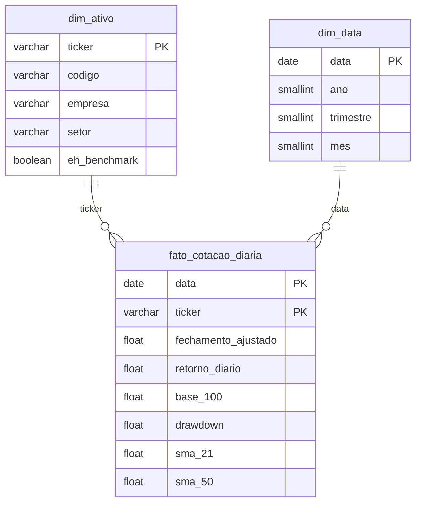

- **Grão:** 1 ativo × 1 pregão. **Chave primária composta** `(ticker, data)`, que impede duplicados no próprio banco.
- **Regras `CHECK`** (preço > 0, volume ≥ 0, drawdown ≤ 0), **view** `vw_cotacoes` para o app e **Row Level Security** ativado.
- **Consultas SQL analíticas** em `src/consultas.sql` reproduzem os resultados do Python (ex.: PETR4 +228,7%; volatilidade da EGIE3 18,8% a.a.). Detalhes em [`docs/modelo_dados.md`](docs/modelo_dados.md).

---

## 5. Dicionário de Dados

O dicionário completo, com **89 campos** (tipo, unidade, significado financeiro, regra de cálculo e nulos permitidos), está em **[`docs/dicionario_dados.md`](docs/dicionario_dados.md)**. Principais campos da base analítica:

| Campo | Tipo | Significado financeiro | Regra de cálculo |
|---|---|---|---|
| `data` | datetime / DATE | Dia do pregão | ISO 8601, sem fuso horário |
| `codigo` | string | Ativo (ex.: PETR4, IBOV) | Ticker sem `.SA` |
| `setor` | string | Macrossetor | Cadastro em `src/config.py` |
| `fechamento_ajustado` | float | Preço que reflete o ganho total do acionista | *Adj Close* × fator de evento societário |
| `volume` | int | Ações negociadas no dia | Fonte (nulo → 0) |
| `volume_financeiro` | float (R$) | Valor negociado (estimativa) | Fechamento × volume |
| `retorno_diario` | float (fração) | Variação sobre o pregão anterior | P(t) ÷ P(t−1) − 1 |
| `base_100` | float | Valor de R$ 100 investidos no 1º dia | 100 × P(t) ÷ P(1º dia) |
| `retorno_acumulado` | float (fração) | Ganho desde o 1º dia | Base 100 ÷ 100 − 1 |
| `drawdown` | float (≤ 0) | Distância do topo histórico | P(t) ÷ máximo acumulado − 1 |
| `sma_21` / `sma_50` | float (R$) | Tendência de curto e médio prazo | Média dos últimos 21 / 50 preços ajustados |
| `pregao_sintetico` | bool | Dia sem dado real na fonte | Volume 0 e preço igual ao anterior |
| `volatilidade_anual` | float (fração) | Risco anualizado | Desvio-padrão dos retornos diários × √252 |
| `sharpe_empirico` | float | Retorno por unidade de risco | Retorno anualizado ÷ volatilidade (taxa livre de risco = 0) |

> Convenção: percentuais são gravados como **fração decimal** (0,0213 = 2,13%); o app formata para %.

---

## 6. Tecnologias e Bibliotecas

| Tecnologia | Versão | Uso | Por que foi escolhida |
|---|---|---|---|
| **Python** | 3.14 | Linguagem de todo o projeto | Mesma versão do ambiente do Streamlit Cloud (validada por *smoke test* antes do desenvolvimento) |
| **pandas** | 3.0 | ETL e cálculos | Padrão de mercado para dados tabulares; funções de janela (`rolling`, `cummax`, `pct_change`) cobrem todos os indicadores |
| **NumPy** | 2.5 | Cálculo numérico | Base do pandas; anualização (√252) |
| **yfinance** | 1.7 | Coleta das cotações | Acesso gratuito ao histórico da B3 com *Adj Close* |
| **PostgreSQL (Supabase)** | 17 | Banco na nuvem | PostgreSQL gerenciado e gratuito, com *connection pooler* compatível com o Streamlit Cloud |
| **SQLAlchemy + psycopg2** | 2.1 / 2.9 | Conexão e carga | Exigidos pelo `st.connection(type="sql")`; driver informado explicitamente porque o SQLAlchemy 2.1 mudou o padrão para o psycopg 3 |
| **Streamlit** | 1.66 | Data App | Desenvolvimento rápido em Python com cache, `session_state` e deploy gratuito |
| **Plotly Express** | 7.1 | Gráficos | Interatividade nativa (zoom, hover, legenda clicável), exigida no edital |
| **Jupyter** | – | EDA (`notebooks/eda.ipynb`) | Prototipagem dos cálculos e gráficos antes do app |
| **Git + GitHub** | – | Versionamento (GitFlow) | Branches `main`, `develop` e `feature/*` com Pull Requests |
| **Trello** | – | Gestão ágil (Kanban) | Planejamento e rastreio de cada entrega |

---

## 7. Principais Resultados e Evidências Numéricas

*Período completo: 04/01/2021 a 28/12/2023, 745 pregões.*

### KPIs da carteira

| Retorno médio da carteira | Ativo destaque | Menor performance | Volatilidade média |
|---|---|---|---|
| **+60,6%** (+47,4 p.p. vs Ibovespa) | **PETR4** (+228,7%) | **BBDC4** (−6,9%) | **33,4% a.a.** (+13,6 p.p. vs Ibovespa) |

### P1 · Base 100: quanto valeriam R$ 100

| Ativo | Valor final | Ativo | Valor final |
|---|---|---|---|
| PETR4 | **R$ 328,69** | VALE3 | R$ 118,11 |
| PRIO3 | R$ 308,32 | **Ibovespa** | **R$ 113,18** |
| EMBR3 | R$ 267,50 | WEGE3 | R$ 103,51 |
| ITUB4 | R$ 150,18 | ABEV3 | R$ 102,57 |
| GGBR4 | R$ 130,79 | RENT3 | R$ 99,75 |
| EGIE3 | R$ 125,35 | KLBN11 | R$ 99,20 |
| | | BBDC4 | **R$ 93,07** |

**7 de 12** ações superaram o Ibovespa; **3** terminaram abaixo de R$ 100.

**Retorno médio por setor dentro de cada ano** (do 1º ao último pregão do ano):

| Setor | 2021 | 2022 | 2023 |
|---|---|---|---|
| Energia | +17,2% | **+41,8%** | **+55,3%** |
| Financeiro | −15,7% | +3,7% | +37,1% |
| Indústria & Materiais | **+40,8%** | +2,0% | +11,5% |
| Consumo | −8,6% | +3,4% | +14,8% |
| *Ibovespa* | *−11,6%* | *+5,9%* | *+26,1%* |

O setor de **Energia foi o único com retorno médio positivo e crescente nos três anos**.

### P2 · Risco × Retorno

| Ativo | Retorno a.a. | Volatilidade a.a. | Sharpe empírico |
|---|---|---|---|
| **PETR4** | 49,6% | 39,4% | **1,26** |
| PRIO3 | 46,4% | 46,8% | 0,99 |
| EMBR3 | 39,6% | 46,8% | 0,84 |
| ITUB4 | 14,8% | 26,9% | 0,55 |
| EGIE3 | 8,0% | **18,8%** | 0,42 |
| *Ibovespa* | *4,3%* | *19,8%* | *0,22* |

A **EGIE3 foi a única ação com mais retorno e menos volatilidade que o Ibovespa**: o quadrante "ideal" do gráfico de dispersão.

### P3 · Distribuição dos retornos diários

- **3,3%** dos pregões das ações variaram mais de **±5%** em um único dia.
- Pior dia: **PETR4, −20,7% em 22/02/2021**. Maior alta: **PRIO3, +17,9% em 05/11/2021**.
- Caudas mais pesadas: **BBDC4** (curtose 9,0 e assimetria −0,99) e **PETR4** (curtose 7,6 e assimetria −0,87). Quedas fortes foram mais frequentes que altas fortes nesses papéis.

### P4 · Drawdown (queda a partir do topo)

| Mais resilientes | Drawdown máx. | Menos resilientes | Drawdown máx. |
|---|---|---|---|
| **EGIE3** | **−17,7%** (05/08/2021) | **EMBR3** | **−58,3%** (11/07/2022) |
| ITUB4 | −23,9% | WEGE3 | −49,5% |
| *Ibovespa* | *−26,5%* | BBDC4 | −46,0% |

Só **2 de 12** ações tiveram queda máxima menor que a do Ibovespa. **A EMBR3 combinou o 3º maior retorno com a maior queda**: retorno alto não significou trajetória tranquila.

### P5 · Médias móveis

- A **PETR4** ficou acima da SMA 50 em **72%** dos pregões com média disponível, com 17 cruzamentos entre SMA 21 e SMA 50 (9 de alta e 8 de baixa), e terminou 2023 com preço e SMA 21 acima da SMA 50.

### Correlação entre as ações

- Média das correlações entre pares de ações: **0,26**. Par mais correlacionado: **BBDC4 × ITUB4 (0,81)**, do mesmo setor. Menos correlacionados: **EGIE3 × VALE3 (0,06)**, um potencial de diversificação entre setores.

---

## 8. Discussão e Limitações da Análise

**Interpretação:** os resultados mostram **dispersão alta entre ativos e setores** num mesmo período. Por isso, a escolha dos ativos pesou mais que o "mercado" como um todo, com o Ibovespa rendendo +13,2% e a carteira entre −6,9% e +228,7%. O cruzamento de retorno com volatilidade e drawdown mostra que **os maiores retornos vieram acompanhados de risco maior** (PETR4, PRIO3 e EMBR3 com volatilidade acima de 39% a.a.), enquanto a EGIE3 se destacou pela estabilidade.

**O que NÃO é possível inferir a partir desta análise:**

- **Causalidade.** A análise é descritiva. Não é possível afirmar, por exemplo, que o setor de energia subiu *por causa* do petróleo ou da política de dividendos, nem que bancos caíram *por causa* dos juros. Correlação não implica causalidade; atribuir causas exigiria um modelo econométrico com variáveis explicativas.
- **Previsão.** Desempenho passado não garante resultados futuros. 2021–2023 foi um período específico (alta da Selic, eleições, choques de commodities).

**Limitações dos dados e dos métodos:**

| Limitação | Efeito |
|---|---|
| **Sharpe com taxa livre de risco = 0** | Com a Selic elevada em 2022–2023, o Sharpe descontando o CDI seria **menor para todos os ativos**; a comparação *entre* ativos é válida, mas o nível absoluto é otimista |
| **Volume financeiro estimado** (fechamento × quantidade) | Não é o valor oficial da B3; usado só como tamanho relativo (liquidez) |
| **Fonte não oficial** (Yahoo Finance) | Teve lacunas tratadas e documentadas: 3 pregões sintéticos, cisão XP/ITUB4 não ajustada e troca de código EMBR3 → EMBJ3 |
| **Retorno médio da carteira** | Média simples dos retornos (carteira com pesos iguais e sem rebalanceamento); não considera custos nem impostos |
| **Universo de 12 ações** | Escolhido pelo edital; não representa todo o mercado |
| **Retornos por setor** | Setores com 2 ativos (Financeiro, Consumo) são muito sensíveis a um único papel |

---

## 9. Aplicação Profissional e Decisões de Negócio

| Perfil | Como o painel apoia a decisão |
|---|---|
| **Investidor pessoa física** | Comparar ativos de preços diferentes na mesma base (Base 100) e enxergar a "dor máxima" (drawdown) antes de investir, alinhando a escolha à própria tolerância a perdas |
| **Gestor de carteira / analista** | Avaliar o retorno **ajustado ao risco** (Sharpe), identificar ativos que dominam o índice e usar a correlação para diversificar entre setores |
| **Comitê de investimentos / diretoria financeira** | Visão executiva em 4 KPIs com comparação automática ao Ibovespa, filtrável por período (ex.: só o ano de alta de juros) e por setor, com exportação dos dados para relatórios |
| **Área de risco** | Distribuição dos retornos (curtose e pior dia) para dimensionar cenários de estresse que a volatilidade sozinha não mostra |

> O painel é uma ferramenta de **análise descritiva**; não constitui recomendação de compra ou venda.

---

## 10. Demonstração do Data App (Streamlit)

🔗 **App publicado:** https://andre-performance-b3.streamlit.app/

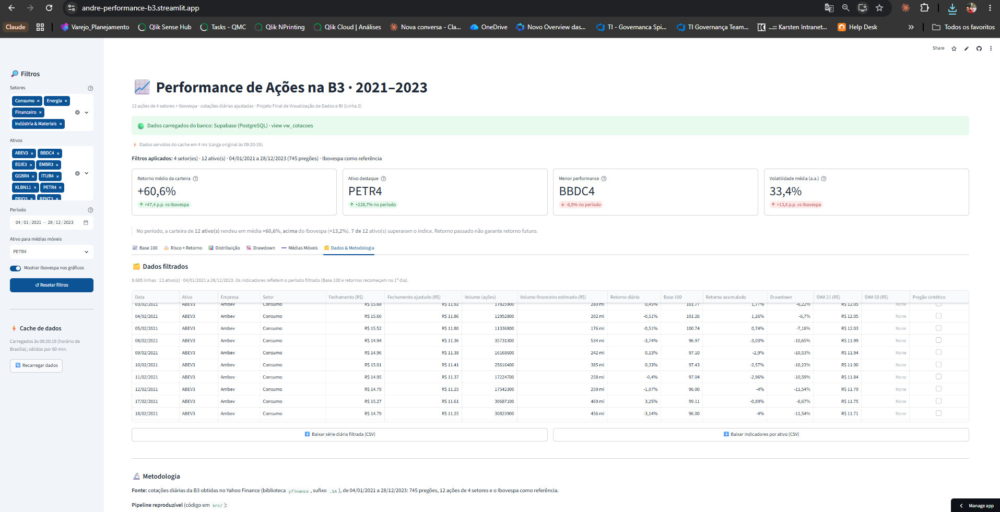

### Guia de navegação

| Área | O que fazer |
|---|---|
| **Barra lateral (🔎 Filtros)** | Escolher **setores** (a lista de ativos se ajusta sozinha), **ativos**, **período**, o ativo das **médias móveis** e se o **Ibovespa** aparece nos gráficos. **↺ Resetar filtros** volta ao estado inicial |
| **Faixa de status** | 🟢 verde = dados do Supabase · 🟠 laranja = contingência CSV (mesmos números) |
| **KPIs** | 4 cartões com delta contra o Ibovespa; passe o mouse no **(?)** para ver a fórmula |
| **Abas** | Uma pergunta de negócio por aba, no formato **contexto → gráfico → insight → ação** |
| **Gráficos** | Passe o mouse para ver valores; clique na legenda para esconder uma série e dê **duplo clique** para isolá-la |
| **🗂️ Dados & Metodologia** | Tabela filtrada, **download CSV** (abre direto no Excel em português), fórmulas, relatório de qualidade e limitações |

### Requisitos técnicos atendidos

| Requisito (item 4.4 / 4.5) | Implementação | Evidência |
|---|---|---|
| Conexão resiliente | `st.connection("postgresql", type="sql")` + `try/except` com CSV | 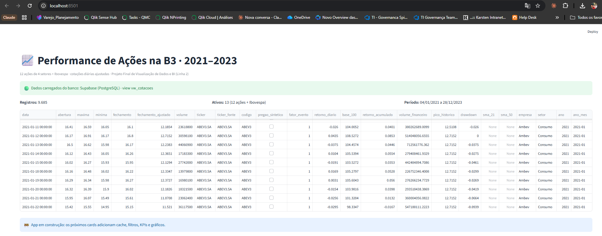 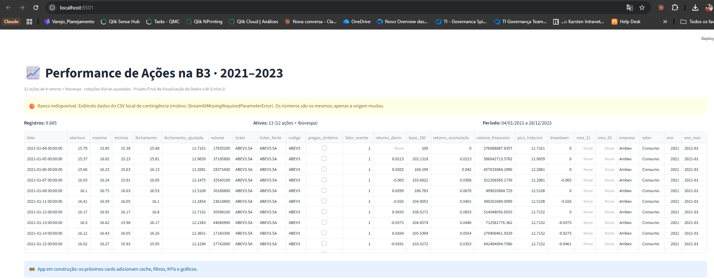 |
| Credenciais seguras | `.streamlit/secrets.toml` no `.gitignore`; secrets no painel do Streamlit Cloud | Nenhum secret no histórico do Git |
| Cache | `@st.cache_data(ttl=3600)` em consultas e cálculos: ~7 s na 1ª leitura e poucos ms do cache | 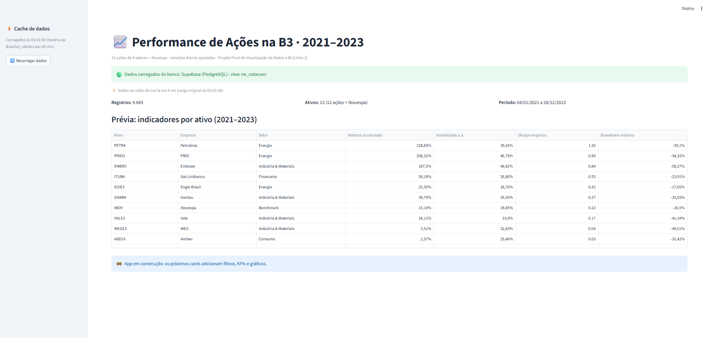 |
| Filtros e estado | Filtros cruzados (setor → ativos), `st.session_state` e botão de reset | 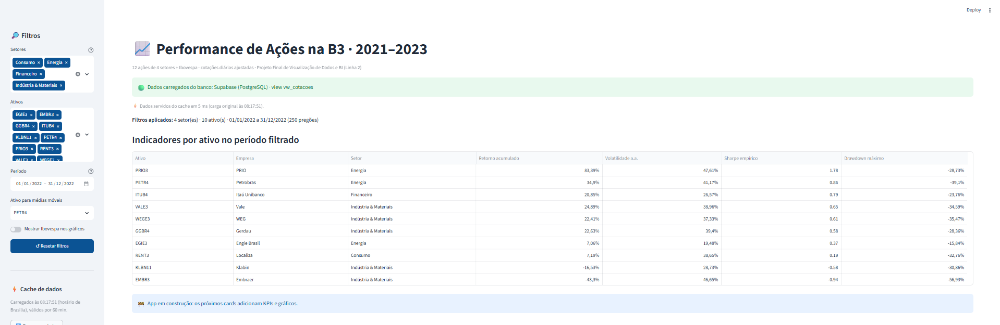 |
| KPIs com delta | 4 `st.metric` com `st.columns` | 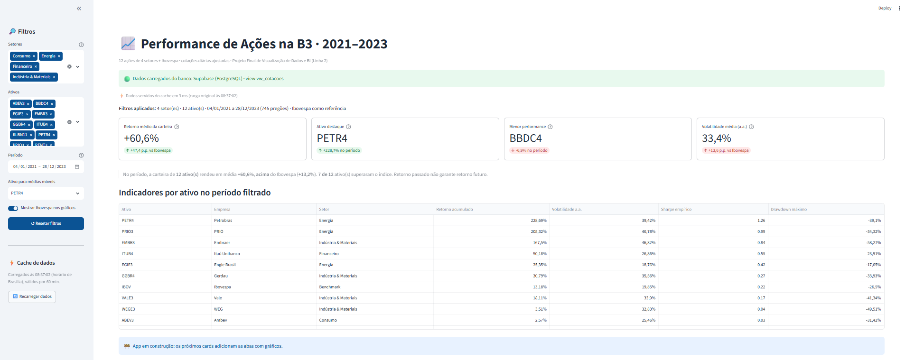 |
| Abas + 5 gráficos da grade oficial | `st.tabs` com 6 abas e 10 gráficos Plotly | Abaixo |
| Exportação | `st.download_button` (2 arquivos CSV) | Aba Dados & Metodologia |

### Abas analíticas

| P1 · Base 100 | P2 · Risco × Retorno |
|---|---|
| 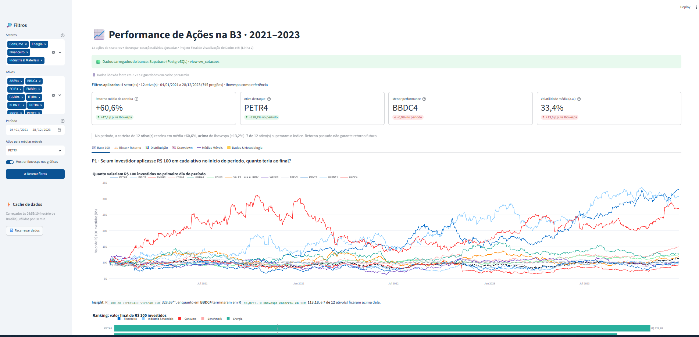 | 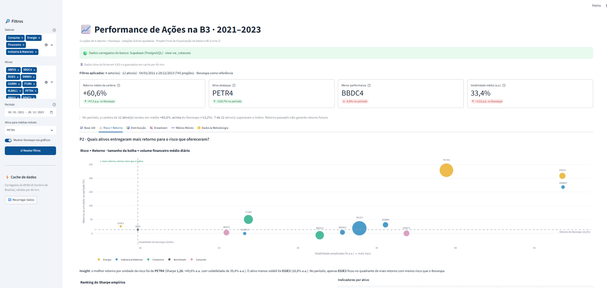 |
| **P3 · Distribuição** | **P4 · Drawdown** |
| 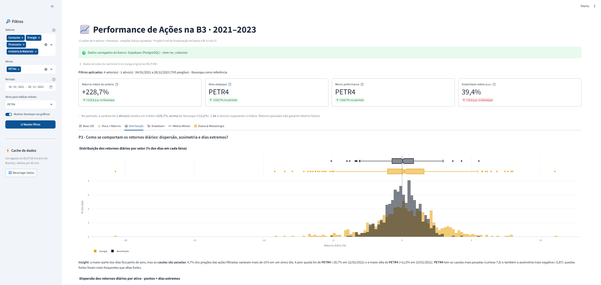 | 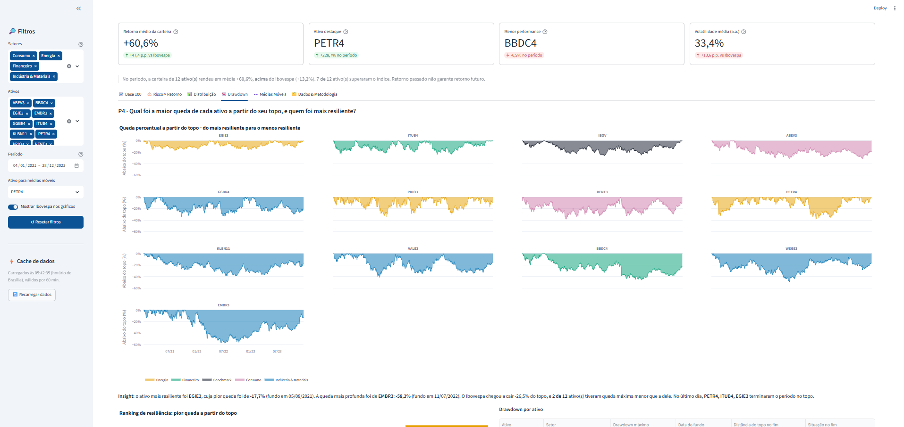 |
| **P5 · Médias Móveis** | **Dados & Metodologia** |
| 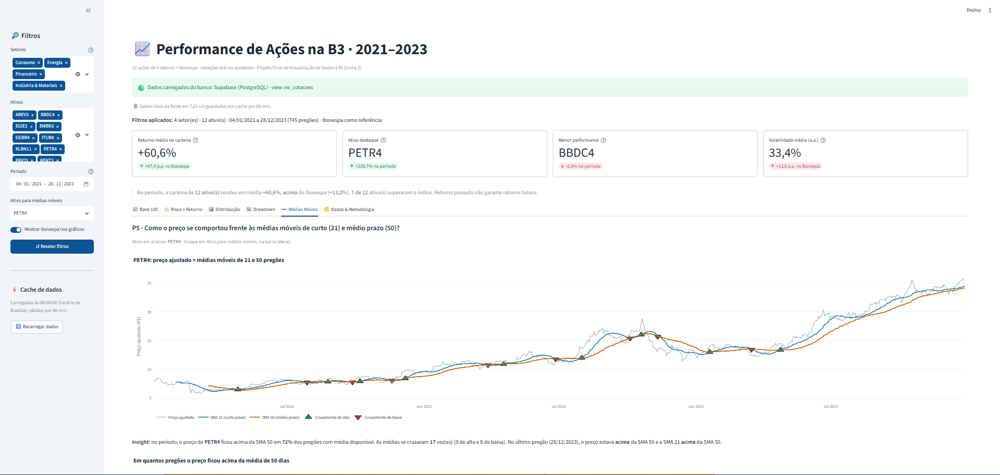 | 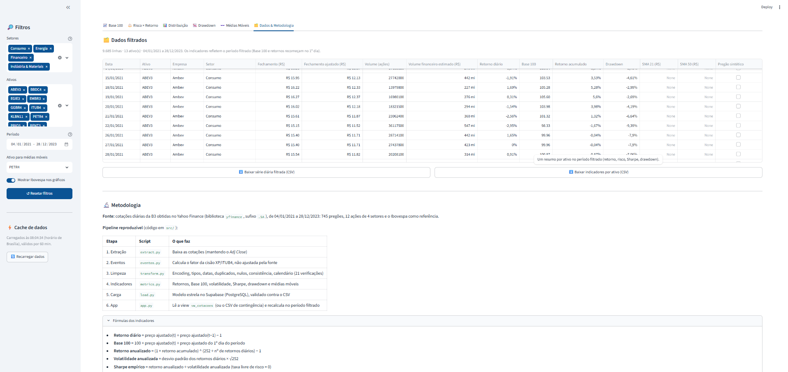 |

**Boas práticas de UX aplicadas (Semana 05):** Pirâmide Invertida em cada aba; **paleta fixa por setor** (Okabe-Ito, segura para daltonismo) igual em todos os gráficos; formatação brasileira (R$ 1.234,56 e vírgula decimal); *small multiples* no drawdown para reduzir a carga cognitiva; e as heurísticas de Nielsen de **visibilidade do estado do sistema** (faixa de origem dos dados e de cache) e **prevenção de erros** (avisos para filtros vazios ou período curto).

---

## 11. Como Executar Localmente

**Pré-requisitos:** Python 3.14 e Git.

```powershell
# 1. Clonar o repositório
git clone https://github.com/Andre-Abranjo-Ramos/turma02-visualizacao-dados-Projeto-modulo-02.git
cd turma02-visualizacao-dados-Projeto-modulo-02

# 2. Criar e ativar o ambiente virtual
py -3.14 -m venv .venv
.\.venv\Scripts\Activate.ps1          # Linux/macOS: source .venv/bin/activate

# 3. Instalar as dependências (app + notebook)
pip install -r requirements-dev.txt

# 4. (Opcional) Configurar o banco: copie o modelo e preencha com os dados do seu Supabase
copy .streamlit\secrets.toml.example .streamlit\secrets.toml

# 5. Rodar o app
streamlit run app.py
```

> **Sem o passo 4** o app funciona normalmente: ele usa o CSV de contingência versionado em `data/processed/`.

**Reproduzir o pipeline completo** (a partir da raiz do projeto):

```powershell
python -m src.extract     # 1. baixa as cotações         -> data/raw/cotacoes_raw.csv
python -m src.eventos     # 2. fator da cisão XP/ITUB4    -> data/raw/eventos_societarios.csv
python -m src.transform   # 3. limpeza e validação        -> data/processed/cotacoes_limpas.csv
python -m src.metrics     # 4. indicadores                -> data/processed/cotacoes_tratadas.csv
python -m src.load        # 5. carga no Supabase (requer secrets.toml)
```

---

## 12. Estrutura de Pastas

```
├── data/
│   ├── raw/                      # Base bruta (fiel à fonte), cadastro de ativos e fator da cisão
│   └── processed/                # Base limpa, base com indicadores (contingência do app),
│                                 # resumo por ativo e relatório de qualidade
├── docs/
│   ├── img/                      # Prints de evidência usados neste README
│   ├── dicionario_dados.md       # Dicionário completo (89 campos)
│   └── modelo_dados.md           # Modelo estrela com diagrama e decisões
├── notebooks/
│   └── eda.ipynb                 # Análise exploratória das 5 perguntas de negócio
├── src/
│   ├── config.py                 # Parâmetros centrais: ativos, setores, período, caminhos relativos
│   ├── extract.py                # Extração (yfinance)
│   ├── eventos.py                # Fatores de eventos societários (cisão XP/ITUB4)
│   ├── transform.py              # Limpeza e validação (21 verificações)
│   ├── metrics.py                # Indicadores financeiros (reutilizados pelo app)
│   ├── load.py                   # Carga no Supabase
│   ├── schema.sql                # Modelo dimensional (estrela)
│   └── consultas.sql             # Consultas analíticas em SQL
├── .streamlit/
│   ├── config.toml               # Tema visual
│   └── secrets.toml.example      # Modelo de credenciais (o real fica fora do Git)
├── app.py                        # Data App Streamlit
├── requirements.txt              # Dependências do deploy (versões fixadas)
├── requirements-dev.txt          # + Jupyter para o ambiente local
├── .gitignore                    # Protege .venv, caches e secrets.toml
└── README.md
```

Todos os caminhos de arquivo são **relativos** (`pathlib`), sem dependência do computador do autor (item 4.3).

---

## 13. Gestão Ágil e Links do Projeto

### Kanban no Trello

🔗 **Quadro público:** https://trello.com/b/95esWOEL/projetofinalt2

Colunas **Backlog → A Fazer → Em Andamento → Concluído**, com **um card por entrega** (ex.: "ETL - tratar nulos, duplicados e tipos de dados", "Streamlit - criar cartões de KPI com st.metric e deltas"). Cada card tem o responsável atribuído, especificação técnica, branch, critério de aceite e checklist, e recebe ao final o link do Pull Request correspondente. Foi mantido **apenas um card por vez em "Em Andamento"**.

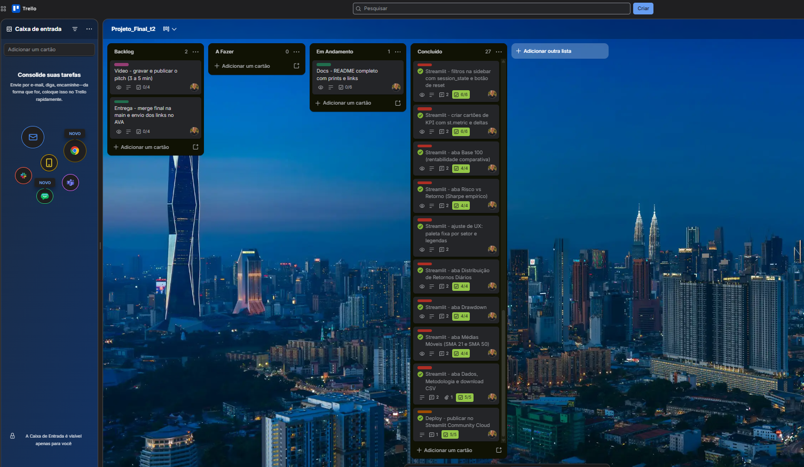

### Versionamento (GitFlow)

- `main`: versão estável publicada no Streamlit Cloud.
- `develop`: integração das funcionalidades.
- `feature/*`: uma branch por card, **todas preservadas** após o merge.
- Integração por **Pull Request** (feature → develop) e **release** por PR (develop → main).
- Commits atômicos com mensagens no imperativo (ex.: *"implementa conexão resiliente com supabase e contingência em csv"*).
- **Ocorrências registradas com transparência:** um PR aberto inicialmente com base na `main` e dois commits feitos na `develop` local foram corrigidos **sem reescrever o histórico público**, e documentados nos cards do Trello.

### Links

| | |
|---|---|
| 🚀 Aplicação em produção | https://andre-performance-b3.streamlit.app/ |
| 📋 Quadro Trello | https://trello.com/b/95esWOEL/projetofinalt2 |
| 🎬 Vídeo de apresentação | _link será adicionado após a publicação do vídeo_ |
| 💻 Repositório | https://github.com/Andre-Abranjo-Ramos/turma02-visualizacao-dados-Projeto-modulo-02 |

---

## 14. Autoria e Créditos

**Autor:** André Abranjo Ramos
**LinkedIn:** [linkedin.com/in/andre-abranjo-ramos](https://www.linkedin.com/in/andre-abranjo-ramos/)
**Curso:** Visualização de Dados e Business Intelligence (Turma 2) · SENAI/SC · LAB365 · Sistema FIESC
**Professor:** Savio Ricardo Garcia

### Uso de inteligência artificial

O assistente de IA **Claude (Anthropic)** foi utilizado como **direcionador** do projeto. Ele orientou o planejamento das etapas, propôs a estrutura e o código de cada entrega e apoiou a depuração dos problemas encontrados.

**A validação foi feita pelo autor, em todas as etapas.** Cada passo foi executado no ambiente local, testado e conferido antes de seguir para o próximo:

- execução de todos os scripts do pipeline e conferência das saídas (contagens, relatório de qualidade e conferências manuais dos indicadores);
- verificação dos resultados contra o banco (consultas SQL no Supabase) e no app publicado;
- revisão visual de cada aba, que gerou ajustes de layout e cores;
- tratamento das ocorrências reais do projeto (rede corporativa, troca de código da EMBR3, cisão XP/ITUB4 e correções de versionamento);
- decisões de modelagem e interpretação dos resultados.

### Referências

- **Dados:** Yahoo Finance; documentação da biblioteca [yfinance](https://github.com/ranaroussi/yfinance).
- **Eventos societários:** fatos relevantes e comunicados ao mercado do Itaú Unibanco e da XPart sobre a cisão da participação na XP Inc. (2021); comunicado da Embraer sobre a troca de código EMBR3 → EMBJ3 (2025).
- **Documentação técnica:** [Streamlit](https://docs.streamlit.io) · [Plotly Express](https://plotly.com/python/plotly-express/) · [pandas](https://pandas.pydata.org/docs/) · [SQLAlchemy](https://docs.sqlalchemy.org/) · [Supabase](https://supabase.com/docs).
- **Métodos:** SHARPE, W. F. *The Sharpe Ratio*. The Journal of Portfolio Management, 1994. · Convenção de 252 pregões por ano do mercado brasileiro.
- **Visualização e UX:** KNAFLIC, C. N. *Storytelling com Dados*. Alta Books, 2019. · NIELSEN, J. *10 Usability Heuristics for User Interface Design*. Nielsen Norman Group. · OKABE, M.; ITO, K. *Color Universal Design* (paleta segura para daltonismo).
- **Material da disciplina:** Módulo 2 · Visualização de Dados e BI (SENAI/SC · LAB365).
