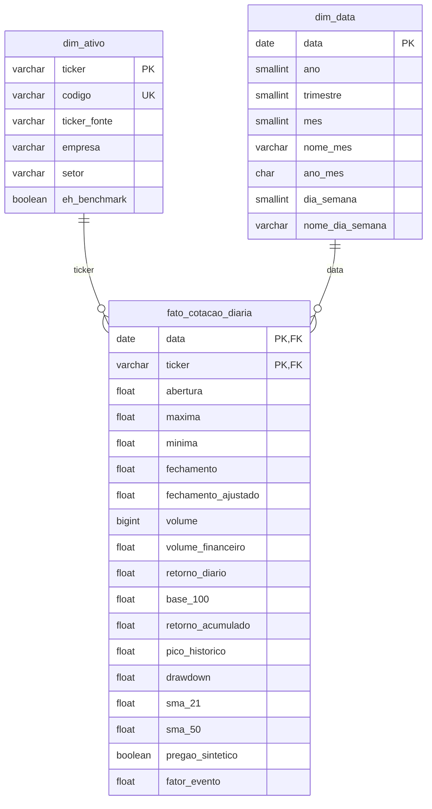

# Modelo de Dados (esquema estrela)

Banco PostgreSQL hospedado no **Supabase**. Script de criação: [`src/schema.sql`](../src/schema.sql).
Consultas analíticas em SQL: [`src/consultas.sql`](../src/consultas.sql).

## Decisões de modelagem

| Decisão | Justificativa |
|---|---|
| **Grão da fato**: 1 ativo × 1 pregão | Menor nível disponível na fonte; qualquer agregação (mês, ano, setor) parte dele |
| **Chave primária composta** `(ticker, data)` | Garante no próprio banco que não existam cotações duplicadas |
| **`dim_ativo`** separada | Empresa e setor ficam em um só lugar (sem repetir em 9.685 linhas) e alimentam os filtros do app |
| **`dim_data`** separada | Agrupamentos por ano, trimestre e mês sem recalcular datas em cada consulta |
| **`CHECK`** em preço, volume e drawdown | Regras de negócio validadas pelo banco, além do pipeline Python |
| **View `vw_cotacoes`** | O app consulta uma única fonte já unida; mesmas colunas do CSV de contingência |
| **Row Level Security ativado** | Bloqueia o acesso público pela API REST do Supabase; o app usa conexão autenticada |
